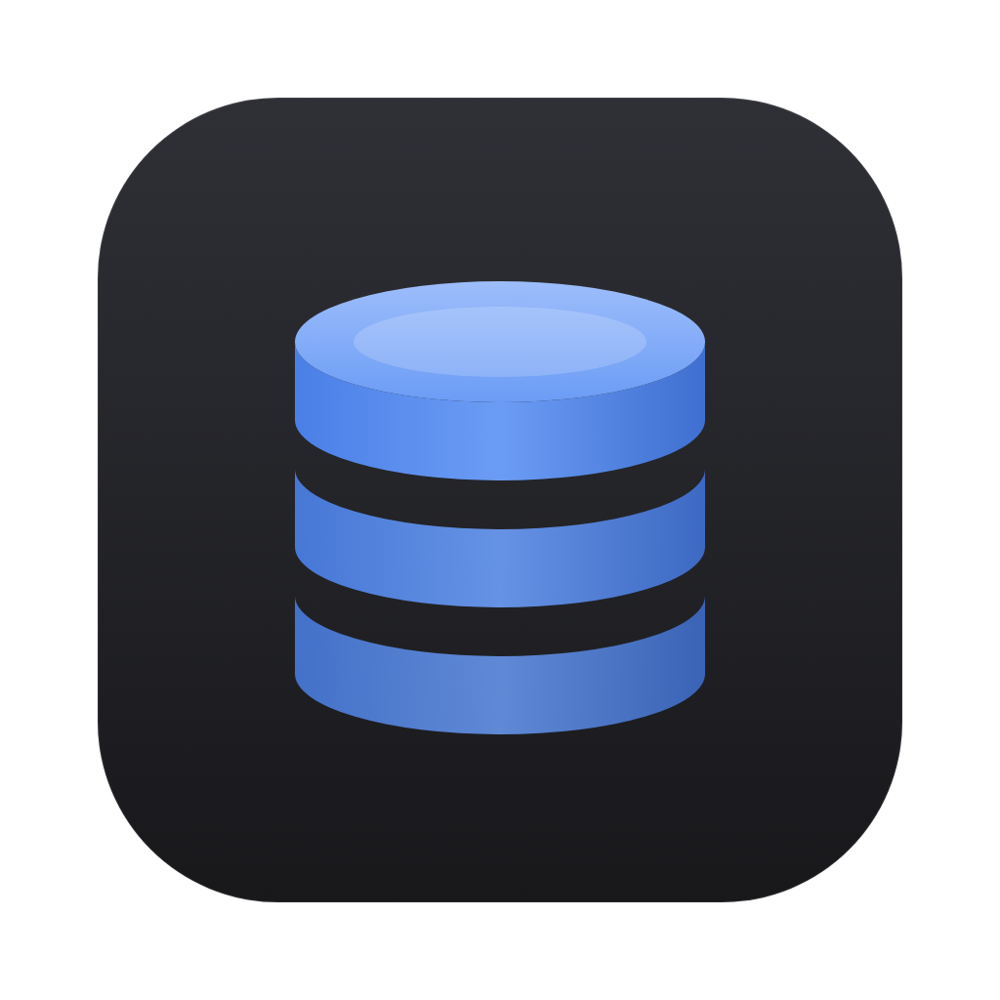
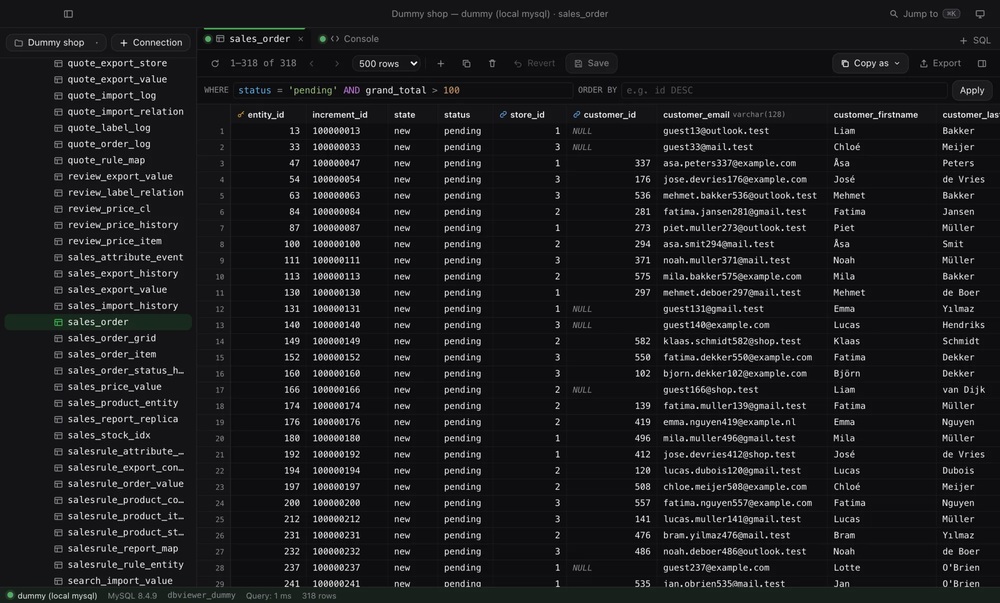

<p align="center"></p>

<h1 align="center">DB Viewer</h1>

<p align="center">A fast, keyboard-first desktop database viewer for PostgreSQL, MySQL and SQLite.<br>Built with Go, Wails v3 and Vue.</p>

<p align="center">
  <a href="https://github.com/AVMG20/dbviewer/releases/latest">Download</a> ·
  <a href="https://dbviewer.bitploy.nl">Website</a>
</p>



## Features

- **Projects** with multiple connections, each with an optional color that tints its tabs
- **Read-only connections**, enforced in the UI, the backend and the database session
- **Staged editing**: inline edits, row inserts and deletes are only written on Save, in one transaction
- **Sidebar filter**: type to filter tables and columns of the open databases; tables expand to show their columns, Esc clears it
- **Jump anywhere** with Cmd/Ctrl+K: tables, columns (`orders total`), connections, saved queries and recent tables
- **Filtering** with raw SQL `WHERE` / `ORDER BY` (highlighting and completion), quick find, per-column filters
- **SQL console** with schema-aware autocomplete, formatting, export, history, saved queries and EXPLAIN; asks before UPDATE/DELETE without WHERE and before writes on red (production) connections
- **Local AI** through [Ollama](https://ollama.com) (optional, Settings → AI): Cmd/Ctrl+\ writes or changes SQL inline, fix failed queries, plain-language table filters, explain a query or its EXPLAIN plan, convert between dialects, and inline suggestions while you type. Ollama gets your prompt and the relevant table and column names; the table filter also sends the distinct values of short status-like columns
- **Selection totals**: count, sum, average, min and max of the selected cells in the status bar
- **Foreign keys**: Cmd/Ctrl-click a value to open the referenced row; mouse back/forward to return
- **Copy as** TSV, CSV, JSON, SQL INSERT or Markdown; paste TSV/CSV from a spreadsheet
- **Connections** over TCP, Unix socket or SSH tunnel (agent, `~/.ssh/config`, default keys); paste a connection URL or Laravel `.env` to fill the form
- **Settings** (Cmd/Ctrl+,): theme, zoom, row height, page size, NULL and date display; all shortcuts under Cmd/Ctrl+/

## Install

Grab the build for your platform from the [latest release](https://github.com/AVMG20/dbviewer/releases/latest).

| Platform | File |
|---|---|
| macOS (Apple Silicon + Intel) | `DB-Viewer-macos-universal.zip` |
| Windows | `DB-Viewer-windows-x64-setup.exe` or `-portable.zip` |
| Linux | `DB-Viewer-linux-amd64.deb` or `.tar.gz` (needs GTK 4 + WebKitGTK 6) |

The builds are not code-signed yet. On macOS, after moving the app to Applications:

```sh
xattr -dr com.apple.quarantine "/Applications/DB Viewer.app"
```

## Build from source

Requirements: Go 1.26+, Node 22+, and the [Wails v3 CLI](https://v3.wails.io):

```sh
go install github.com/wailsapp/wails/v3/cmd/wails3@v3.1.0
wails3 doctor            # checks platform dependencies

wails3 task dev          # desktop window with hot reload
wails3 task package      # production build in bin/
```

`wails3 task dev:browser` runs the UI in a normal browser at http://localhost:9245 with the Go backend in server mode.

## Releases

Pushing a tag like `v0.2.0` runs [the build workflow](.github/workflows/build.yml) on macOS, Windows and Linux and publishes the packages to a GitHub release.

## License

[MIT](LICENSE)
